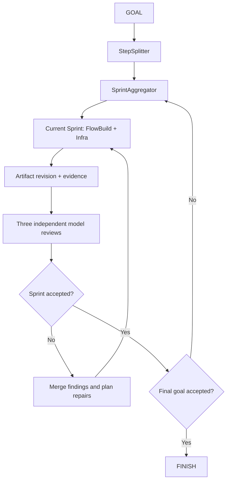

# AIMEIN 执行模式：设计与使用

- 归档日期：2026-10-26（Asia/Shanghai）
- 文档版本：0.8（2026-10-28 更新）
- 状态：执行模式、3D 建设沙盘、对象意见、评委工坊、沉浸式准备、常驻沙盘与可操作装配台已在当前项目实现；用法及实现选择见第 12–18 节
- 项目：AgentWithU
- 用途：集中保存本次讨论，供用户后续补充细节，并作为 AIMEIN 后续设计与实施的独立参考入口。

## 文档使用约定

后续涉及 AIMEIN 的工作应先阅读本文，以本文及用户随后明确补充的内容为设计依据。用户可以直接在本文件补充细节；如果迁移到另一份独立文件，应在这里登记新文件路径及迁移范围，避免同时维护两套相互冲突的定义。

本文区分已确认决定、原图语义和实现选择。第 1–11 节保留初始讨论；其中的建议不能自动视为用户既定需求。当前实现以第 12–18 节及代码为准，不替代现有执行权限、用户控制和项目约束。

最初只归档设计；用户随后明确要求“在当前项目目录实装该模式，交互性和 ue 体验要好”，因此完成了首版实现。此变更未启动或修改生产 Session，也未归档现有 OpenSpec change。

## 1. 已确认的决定

| 项目 | 已确认内容 |
| --- | --- |
| 名称 | AIMEIN，来自用户提出的 AIM ME IN 简写。代码标识建议使用 `aimein`。 |
| 产品定位 | 希望在 AgentWithU 中扩展这套框架，作为一种执行模式。 |
| FlowBuild | 建设目标产品的功能流程。 |
| 评审组成 | 三个不同模型，各自新开独立会话进行评审。 |
| 百分比含义 | 当前 Sprint 所负责部分的成熟程度。 |
| Sprint 编排 | 动态生成，根据目标、依赖和实际成果组织阶段。 |
| 后续依据 | 将模式归档，相关细节集中到独立文件，后续工作基于该文件推进。 |

对名称的解释建议：将 `AIM ME IN` 连写，合并连续的两个 M，得到 `AIMEIN`。这只是名称说明，不扩展为新的功能要求。

## 2. 核心定义

AIMEIN 围绕整体目标动态组织 Sprint。每个 Sprint 建设一组目标产品的功能流程及其必要基础设施，设定该范围的成熟度要求；执行后，由三个不同模型在独立会话中评审，再决定推进下一阶段、修补当前阶段或暂停处理问题。

整体目标、阶段成果和一次执行尝试分别记录。阶段数量不预先固定为五个，阶段通过也不直接等于整体目标完成。

## 3. 原图与模块职责

讨论来源为用户提供的 Aimein 框架图，其中包括 GOAL、StepSpliter、target B1/B2/B3、SpritAggregator、Sprint1–5、FlowBuild、Infra、E5 和 D4 回路。本文以文字保留其核心含义，不依赖临时附件路径。

| 模块 | 当前解释 | 确定程度 |
| --- | --- | --- |
| GOAL | 用户希望达成的整体目标、约束及最终验收条件 | 基于原图的设计解释 |
| StepSplitter | 拆出子目标、相关能力、依赖和验收条件 | 基于原图的设计解释 |
| target B1/B2/B3 | 拆出的子目标示例；数量由实际目标决定 | 基于原图的设计解释 |
| SprintAggregator | 从子目标中组合出逐步可用、可验证的交付阶段 | 基于原图的设计解释 |
| FlowBuild | 建设目标产品的功能流程 | 用户明确确认 |
| Infra | 支撑功能流程的公共基础设施，随阶段演进 | 设计建议，详细边界待补充 |
| E5 | 暂解释为执行成果的评估与反馈汇合点 | 原图标记，具体定义待确认 |
| D4 | 暂解释为将成果、缺口及依赖变化送回规划的反馈回路 | 原图标记，具体定义待确认 |
| FINISH | 当前整体 GOAL 达到最终验收要求 | 设计建议，最终规则待补充 |

图中的 `StepSpliter`、`SpritAggregator` 在本文分别规范写作 `StepSplitter`、`SprintAggregator`。这不代表代码类型名已经确定。

原图示例表达：某一 Sprint 预期达到其成熟度要求，三个新会话评审都认可时继续下一阶段；否则合并意见并在当前阶段继续一轮。三个评审明确采用不同模型；具体的通过协议尚待规格化。

## 4. Sprint 与执行尝试

建议采用两级结构：

- **Sprint**：希望达到的一种阶段性产品状态，包含建设范围、成熟度目标和验收条件。
- **Attempt**：为了达成该 Sprint 而进行的一次规划、实施、验证与评审尝试。

同一个 Sprint 可以经历多次 Attempt。当前阶段未通过时保留已经有效的成果，根据缺口继续修补。重新生成计划、增加尝试次数或换一个编号，本身不代表产品取得进展。

建议的执行关系如下：



该图表达主路径。实际状态机还需要补齐暂停、取消、评审不可用、结果未知、计划修订和恢复路径。

## 5. 成熟度语义

用户已确认百分比表示当前 Sprint 所负责部分的成熟程度。因此，原图中 20%、40%、70%、50%、85% 不构成一条统一的累计完成率曲线。不同建设范围的百分比不能直接比较；Sprint3 的 70% 和 Sprint4 的 50% 可以分别指向不同范围。

这些具体数值是原图示例。尚未确定统一的评分公式、权重或默认阈值，不应直接硬编码为五个阶段。

建议每个 Sprint 在执行前明确以下内容：

| 字段 | 含义 |
| --- | --- |
| 建设范围 | 当前负责哪些功能流程与基础设施，关联哪些子目标 |
| 成熟度目标 | 目标数值及其对应的实际产品状态 |
| 必须满足的条件 | 必须跑通的场景、质量底线和必要验证 |
| 暂缓内容 | 允许留给后续阶段的能力和已知限制 |
| 既有能力约束 | 本阶段必须维持的已验收行为及其证据 |

成熟度应有可核对的文字锚点。例如，一条功能流程可以从“核心路径实际跑通、适用范围有限”，演进到“主要场景完整、必要异常处理可用”，再到“关键边界、集成与回归验证齐备”。这些是解释示例，具体数值映射需要另行定义。

模型对成熟度的判断应标识为评审判断；构建、测试和运行证据分别记录。整体 GOAL 的完成需要单独验收，不能单凭一个高分或最后一个 Sprint 的编号宣布完成。

## 6. 动态 Sprint 编排建议

已确认 Sprint 动态生成。具体调度建议采用滚动规划：保留整体目标、当前能力和待解决问题的全貌，详细确定当前 Sprint，允许调整尚未开始的阶段。

每次规划应回答：

1. 当前产品已经具备哪些经过验证的能力？
2. 距离整体目标还缺什么，各项之间有什么依赖？
3. 下一步交付哪个可验证的结果最有价值？
4. 该结果需要达到什么成熟程度，如何判断达到？

建议当前 Sprint 开始后，将建设范围、成熟度标准及验收条件固定到一个计划版本。发现遗漏依赖或拆分问题时可以修订，但应保留原因、差异与旧评审；不能靠隐去缺口、降低标准或改编号制造通过。

后续阶段应保持已验收能力。相关代码、条件或环境改变时定向复验受影响的证据，无关成果允许继续复用。

| 当前结果 | 建议动作 |
| --- | --- |
| 三模型均通过，整体目标仍有缺口 | 根据当前成果生成下一 Sprint |
| 存在具体实现缺陷 | 留在当前 Sprint，进行下一次修补尝试 |
| 发现遗漏依赖或拆分不合理 | 修订计划，保留修订原因和原评审记录 |
| 缺少证据或某个评审未完成 | 保持待验状态，处理缺失部分 |
| 重复无进展或预算耗尽 | 暂停，展示已有成果与未解决问题 |
| 当前整体目标验收通过 | FINISH |

以上转换规则是本次讨论提出的设计建议，最终状态名、优先级和例外处理仍需规格化。

## 7. 三模型独立评审建议

确定要求是三个不同模型、三个独立新会话。不同 Backend 配置不必然等于不同模型，需要记录实际使用的模型身份与运行参数。

建议三者接收同一份 GOAL、当前 Sprint 范围、成熟度标准，以及同一版本的成果和证据。三者均覆盖完整验收条件，可以分别侧重目标符合度、实现可靠性和集成回归，但侧重点不替代共同标准。

建议每份评审包含：

- 评审身份、模型与成果版本。
- 成熟度判断及依据。
- 是否通过当前阶段。
- 证据引用与具体必修缺口。
- 可留给后续规划的建议。
- 未能核实的内容及原因。

建议先独立提交，再汇总结果。按照原图意图，以三者均明确通过且必要证据有效作为推进条件；不通过平均分冲抵某一模型发现的必修缺口。三者一致仍是评审结论，不能补足缺失的真实验证。

模型超时、不可用、输出无效或结果未知应与“实现不通过”分别表达。缺失的评审不计为通过，不静默替换为同一模型的多个席位。重试、替换模型和分歧裁决策略尚待确定。

评审期间应核对成果版本一致性。相关成果或验收条件变化后，旧结论需要重新判断适用性。评审负责核对产物与证据；需要产生写入副作用的构建、测试或应用运行，应由符合现有执行约束的步骤完成。

修补依据应合并重复问题，保留真实分歧。反复无进展时按预算和停滞规则暂停，避免无限重评直到偶然得到通过。

## 8. FlowBuild 与 Infra 协同示例

以下以聊天产品说明阶段交付方式，不是固定模板：

| 阶段成果 | FlowBuild | Infra |
| --- | --- | --- |
| 最小闭环 | 输入消息并获得回复 | 最小模型调用与消息传输 |
| 连续使用 | 多轮对话、历史恢复 | 会话存储与上下文管理 |
| 完整体验 | 流式响应、停止、错误恢复 | 流事件、取消机制和状态一致性 |
| 质量提升 | 长会话、多会话等场景稳定可用 | 性能、资源治理及回归验证 |

基础设施投入应能追溯到当前功能或明确的后续依赖。功能遗漏可以形成 FlowBuild 修补任务，支撑能力不足可以形成 Infra 修补任务，范围或依赖安排问题则交回 SprintAggregator 调整。

## 9. 与现有项目的接入分析

以下是本次讨论期间对仓库的只读分析，实施时必须重新核对代码；工作区存在其他并行修改。

| 现有位置 | 可参考或复用的能力 |
| --- | --- |
| `src/backend/loop_store.py` | LoopPolicy 角色配置，LoopRecord 阶段、运行参数及证据记录 |
| `src/backend/bridge_ws.py` 的 `_loop_run_agent` | 独立会话、Backend、模型参数、访问模式及调用诊断 |
| `src/backend/bridge_ws.py` 的 `_loop_do_analysis` | 当前单路独立评审流程 |
| `src/backend/loop_control_persistence.py` | 有序写入与状态合并 |
| `src/backend/loop_control_bridge.py` | 人工接管、请求回执及活动保护 |
| `src/backend/loop_delivery.py`、`loop_decisions.py` | 交付证据、停滞判断和调度决定 |
| `src/backend/loop_openspec.py`、`loop_openspec_bridge.py` | OpenSpec 原任务推进及验证修复 |
| `frontend/src/components/SessionWorkbench.tsx`、`ChatPane.tsx` | 工作台展示与执行内容路由 |
| `docs/loop-adaptive-delivery.md` | 现有执行、证据、恢复与安全边界说明 |

建议以独立 AIMEIN 编排器复用共享执行底座。Chat / Engine 属于展示方式，AIMEIN 应保持与展示方式解耦。是否新增 Session 类型、增加执行框架字段，或抽取公共运行接口，尚未确定。

建议新增的概念对象：

- **SprintPlan**：建设范围、关联子目标、依赖、成熟度条件及计划版本。
- **SprintAttempt**：某次实施、验证、修补及结果记录。
- **ReviewSet**：三个模型针对同一成果版本的独立结论和汇总决定。

这些是设计占位名称，尚未形成字段协议。现有调用结果与推送主要按 prepare / execute / analysis 归属，三路评审需要各自的 reviewId，确保输出、状态、取消和恢复不会混合或互相覆盖。

如果使用 OpenSpec 来源，Sprint 应引用真实任务与验收条件，保持原任务进度的权威性。现有 apply 路径会持续推进原任务，接入时需处理“仅推进当前 Sprint 范围”的执行边界，避免跳过阶段验收；跨 Sprint 的部分成果也不能提前勾选尚未完整完成的原任务。

首版建议保留一个执行者、三个独立评审者，先完成动态 Sprint、修补、恢复和人工接管的完整闭环。多执行者并发写入属于后续可讨论的扩展，未被确定为本次要求。

## 10. 待补充的详细设计

1. GOAL 与子目标的结构、验收来源，以及用户修改目标后的影响范围。
2. Sprint 生成和排序规则、规划者选择、计划修订条件。
3. 成熟度的文字锚点、数值计算或判断方式、必修条件与评分的关系。
4. Infra 的具体边界，以及原图 E5、D4 的正式含义。
5. 三模型配置、实际身份核对、评审输入与输出协议。
6. 评审不可用、模型替换、分歧、证据不足及修复后复评策略。
7. Sprint、Attempt、评审与整体运行的预算及停滞规则。
8. FINISH 的最终验收条件，以及待人工事项、部分成果和暂停如何表达。
9. 持久化、断点恢复、迟到结果、取消与退出未知的状态机。
10. Session 模式入口、工作台布局、详情展示及现有 LOOP 兼容策略。
11. OpenSpec 等外部任务来源与 Sprint 范围的对应方式。

这些待定项不能通过采用默认值而变成已确认的用户要求。后续可以先提出具体方案，再随用户明确决定更新本文。

## 11. 决策记录

| 顺序 | 用户输入 | 记录结果 |
| --- | --- | --- |
| 1 | 希望在项目扩展图示执行框架，命名 AIMEIN，来自 AIM ME IN | 确定名称与执行模式方向 |
| 2 | “三个不同模型，各开独立会话评审” | 确定评审组成与上下文独立性 |
| 3 | “是 建设目标产品的功能流程” | 确定 FlowBuild 含义 |
| 4 | “成熟程度” | 确定百分比为当前 Sprint 范围的成熟度 |
| 5 | “动态” | 确定动态 Sprint |
| 6 | 归档模式，后续细节进入独立文件并以其为执行依据 | 建立本文件作为独立设计入口 |
| 7 | 在当前项目实装，注重交互与 UE | 2026-10-27：实现新建入口、动态 Sprint、三方评审与共享执行保护，具体实现选择记录于第 12 节 |

后续变更应记录决定、日期及受影响章节。若用户指定新的独立文件，本节或文首应登记迁移入口；旧讨论中的建议不应覆盖新的明确决定。

## 12. 首版实现与使用

### 开始使用

1. 更新并重启所选执行端，刷新前端，打开 **New Session → AIMEIN**。
2. 选择工作目录及执行连接。配置三个不同模型作为评审，可共用一个支持模型覆盖的 Backend。也可以先创建，再到 **评审与执行设置** 补齐；配置缺失时不允许执行阶段。
3. 输入可验收的产品目标，可补充想法和参考图。确认目标后，点击 **推进下一次尝试**；开启 Auto 后才会自动继续。
4. 在工作台查看 Sprint 的范围与成熟度文字条件、FlowBuild / Infra、三个评审结果。未通过会保留本阶段标准进入修补；历史选择不会因普通状态推送跳回最新记录。
5. 展开 **查看依据与原文**、**目标图与执行记录** 核对证据。**目标与补充** 用于改变后续目标；**停止本轮并查看结果** 保留产物，文件回滚仍属于独立显式操作。

移动端采用单列卡片；高级预算与规划模型设置默认折叠。设置保存失败会显示错误并保留草稿。新建时模式和初始设置随同一次创建请求保存，避免额外保存请求失败而静默丢失配置。

### 本次采用的实现选择

以下是为实装选定的行为，不是对原图所有未定细节的追认。

- 内部继续使用 `session_type=loop` 及既有控制权、环境、停止和持久化保护；`LoopPolicy.executionMode=aimein` 为权威模式。旧记录缺省仍为普通 LOOP。有执行历史后不能原地切换模式。
- 一条 LoopRecord 对应一次 Attempt。阶段未通过时复用同一 Sprint 和冻结计划；通过后动态规划下一个 Sprint。目标、补充或来源范围改变产生新范围，原记录保留。成熟度由规划给出数值及文字含义，由评审判断，不使用固定 20/40/70/85 阶梯。
- 规划输出最多 40 个子目标、24 条阶段条件；依赖必须完整且无环。最多三次只读纠正，仍不合格则暂停。通用执行复用完整任务协议及隔离前置。OpenSpec 来源直接沿用原任务 apply / verify，阶段约束限制当次实施，整体收口还要求原生 verify 通过。
- 三个评审顺次调度，但各用新的独立会话、相同阶段输入与成果版本；不会传入前一位评审报告。可覆盖模型的 Backend 显式提交模型参数；其他 Backend 使用其配置模型。模型 ID 不区分大小写判重，不将账号或推理档位差异当成不同模型；无法探测服务商把不同 ID 映射到同一底层模型的情况。
- 新增的阶段规划与三方评审只接收文字目标、阶段说明、执行输出和工作区证据，不自动向多个模型分发历史想法与补充图片。原有想法展开和执行附件流程保持既有语义；图中关键要求应写入目标或补充文字，便于每位评审核对。
- 每份评审必须覆盖全部阶段条件和子目标；缺失、无效、错误、未知或证据变化均不能通过。三个有效通过才推进阶段；完整目标均已核实、来源自动任务完成、无待纳入补充及真实阻塞才收口。文件存在与三方结论不是机器证明。
- 评审只读核对既有产物及验证记录。需要写入的构建、测试、应用运行由执行步骤完成。Codex 原生隔离仍受当前平台能力约束，其他 Backend 的提示约束不等同操作系统隔离。
- 工作区版本使用 Git 非忽略文件清单；非 Git 目录跳过常见生成目录。上限为 12000 文件、总计 128 MiB、单文件 16 MiB、有界扫描；链接或扫描失败会暂停。证据还须单独核对文件指纹。忽略目录不属于完整工作区覆盖证明。
- 已完成写步骤和有效评审在同一次断点恢复中不重放。评审调用失败或格式无效后，显式继续保留原 Attempt，只补齐失败及未运行评审，每位最多三次新会话调用，失败记录可展开查看。恢复重查身份与成果版本；结果未知的评审不自动重发。停止、未知退出、来源和环境门槛仍优先。新的尝试重新核实已有成果，不自动回滚文件。
- 预算沿用每轮最大执行次数，包含修补尝试。停滞按同轮同目标范围跨 Sprint 累计：首次共同核实完整子目标，或新增阶段条件有此前未核实的文件版本支撑，才计作进展。重复阶段、换条件编号、改写无新证据的报告及分数上涨都不能清零。连续停滞达到 `progressPatience`（默认 3）时暂停 Auto；预算停止显示未完成，现有风险阈值继续作为执行约束。

### 代码与验证入口

- 协议与版本核对：`src/backend/aimein.py`；驱动：`src/backend/aimein_bridge.py`。
- 工作台：`frontend/src/components/AimeinWorkbench.tsx`；设置及共享操作保留在 `LoopPolicyEditor` / `LoopPanel`。
- 回归：`tests/test_aimein.py`；浏览器：`frontend/tests/acceptance/aimein-workbench.spec.ts`。
- 变更设计及任务：`openspec/changes/add-aimein-execution-mode/`。

验证使用临时目录、fake 模型和 `.qa/home` 独立测试数据。覆盖实际通用 prepare/execute 协议门槛、阶段推进与修补、独立会话、配置变化、成果变化、未知评审、恢复、预算及 OpenSpec 接口衔接。浏览器覆盖桌面与 360px 窄屏的阶段历史、证据加载、设置失败草稿、停止和真实 QA Session 创建/重载。没有调用付费模型或声称生产项目已验收。

2026-10-27 验证结果：

| 检查 | 结果 |
| --- | --- |
| `tests.test_aimein` | 30 项通过，含评审失败真实恢复与跨 Sprint 停滞回归 |
| 相邻 LOOP 生命周期、任务协议、OpenSpec 与 Session 回归 | 111 项通过；合计 141 项 |
| `npm run test:home` | 291 项通过 |
| Playwright AIMEIN 工作台，desktop-chromium / narrow-mobile-chromium | 8 项通过，含失败评审历史、显式恢复及桌面/窄屏截图 |
| `npm run build` | TypeScript 与 Vite 构建通过；保留既有大包提示 |
| `openspec validate add-aimein-execution-mode --strict` | 通过 |

本轮复核曾发现“评审失败后重复进入实施”和“阶段通过导致停滞清零”；两项均已修复并纳入回归。
截图使用隔离演示数据，保存于 `.qa/aimein-preview/desktop.png`、`mobile.png` 和 `mobile-reviews.png`；不是生产模型执行结果。

Python 组合回归命令：

```powershell
python -m unittest tests.test_aimein tests.test_loop_continuation tests.test_loop_lifecycle tests.test_loop_stage_details tests.test_loop_openspec_driver tests.test_loop_task_contract_recovery tests.test_loop_task_blockers tests.test_session_store_refresh -q
```

前端目录内的浏览器回归命令：

```powershell
npx playwright test -c playwright.home.config.ts --project=desktop-chromium --project=narrow-mobile-chromium tests/acceptance/aimein-workbench.spec.ts
```

## 13. 建设场景与评委成长（0.3）

用户进一步确认：AIMEIN 应呈现目标逐步建成的过程；成果、观察与工具经验不断积累，意见能进入后续迭代。评委也应持续理解用户、领域与成熟度，通过结构化口味和聚焦文档改善适配性，并支持推荐或主动选择。

### 从场景观察产品

默认进入“建设场景”，采用方块工坊视觉。点击目标灯塔与目标瓶、功能工坊、基础设施、成果架或评委席，右侧显示该对象的范围、证据和意见入口；窄屏上下排列，选择对象会滚动到观察区。共享运行、Auto、停止、恢复、来源和设置控制继续生效。

- **目标灯塔**表达整体方向；**目标瓶**显示所查看版本中三位评审共同核实的整体子目标数。只有带文件版本依据的完整报告才能计算；旧记录或不完整评审显示未知。瓶内覆盖数不是成功证明，整体收口仍由执行门槛决定。
- **阶段成熟度**单独显示，只解释当前 Sprint 范围。轮次、文件数量、校准数和分数上涨都不会填满目标瓶。
- **已实施建筑**保留前面尝试的实施记录；**成果架与建设足迹**可以回看执行原文和不同尝试。建筑是状态示意，不是自动生成的真实产品架构图。
- **阶段记录**保留完整的目标图、步骤、评审原文和失败调用历史；选择历史不会被新推送抢回。

### 意见如何进入后续迭代

从对象提交意见会创建带来源的 Addon：对象类型、源尝试、评审 ID（适用时）与目标修订。意见原文保留，状态区分待规划、已纳入阶段、留待后续、待修补和评审核实。

下一次 AIMEIN 规划冻结最多 40 条未解决意见，并逐条输出理由及关联验收条件，或者说明延后理由。延后项不进入当前实施；执行中晚到的对象意见也不会扩大当前冻结范围。三个评审共同收到冻结意见与处理映射，核对条件是否真正满足原文；只有关联条件全部共同核实后才显示“评审核实”。Addon 的 applied 只代表送达规划，不代表完成。未解决意见阻止整体收口。

意见保留最近最多六条处理事件（较长文本按 24 KB 轨迹上限保留近期事件），包含处理尝试、理由和条件编号，可直接跳转原尝试。提交失败或结果未知保留草稿，不自动重发写入。

### 评委档案与校准

“评委工坊”管理本会话的结构化档案：名称、Backend、明确模型、推理配置、领域、口味和聚焦。

- **口味**记录取舍，例如优先让首次使用清晰；**聚焦**记录应具体核对的内容，例如离线恢复和失败反馈。两者不能修改用户目标或降低验收标准。
- 每档保存当前文档及最近八个历史版本，每次评审冻结自己的文档、模型配置摘要和此前可比校准。独立会话只收到自己的档案，不收到同次其他评委结论。续跑保持原版本，后来的文档编辑用于新尝试。
- 在已完成且使用过档案的评审上记录用户校准：偏好、判断得到确认、误报、漏报或不适配；必须写具体依据。相同评审重复保存更新原校准，不能刷高样本数。
- 偏好不增加能力信用。校准绑定实际评审、模型连接配置摘要和档案版本；连接或文档变化后，旧记录留作历史，不自动当作新组合的能力证据。这不训练模型权重，也不声称用户标注是独立机器证明。

本会话最多 24 个档案、96 条校准，完整文档按需读取，推送只带修订与计数。活动执行、未确认调用或控制权不属于 LOOP 时不允许修改；多窗口保存有修订冲突检查，草稿保留。

### 推荐与跨会话复用

打开工坊会按目标生成本地推荐，也可以填写具体任务和成熟度关注点重新匹配。推荐依据领域/聚焦词匹配，以及**同连接配置、同档案版本**的用户校准；显示匹配理由、确认/误报/漏报/不适配数与样本不足提示。偏好不参与能力加分。推荐最多三个不同模型，不适配的组合不自动入选；用户仍可主动勾选合适组合，显式“选用这三位”才修改后续评审配置。查看和推荐不调用模型。

档案默认属于当前会话，不自动读取或汇入其他项目。用户可以导出 JSON 文档，在另一个会话导入、核对模型连接后保存；导入不携带评分信用或校准。未知连接不可推荐。服务商在同一模型 ID 后静默更换底层模型的情况无法探测，因此推荐不是模型能力榜单。

### 实现与验收入口

- OpenSpec：`openspec/changes/evolve-aimein-world-and-reviewers/`，依赖首版 AIMEIN 变更。
- 档案和意见协议：`src/backend/aimein_learning.py`；执行冻结及意见闭环：`aimein_bridge.py`。
- 场景/观察区：`AimeinWorkbench.tsx`、`AimeinWorld.tsx`；完整记录：`AimeinRecordView.tsx`；档案与推荐：`AimeinReviewLibrary.tsx`。
- 数据保存在原 Session 的 LOOP stage 文件，所有交互仍经 BridgeWS；使用原节点路由、所有权和有序保存队列。
- 新增后端回归：`tests.test_aimein_learning`（11 项）；连同首版 AIMEIN 30 项、相邻 LOOP/Session 111 项，共覆盖 152 项。前端 `test:home` 293 项，桌面/窄屏 AIMEIN 浏览器 12 项。构建和严格规格校验结果记录于本变更 `verification.md`。

截图使用 `.qa/home` 隔离数据，不代表生产模型评审。未打包或重启用户正在运行的桌面应用。后续修改继续以本文和对应 OpenSpec 规格为入口；真实模型验收需在实际配置下单独观察。

## 14. 3D 建设沙盘（v0.4）

建设场景升级为可环视的低多边形浮岛，包含目标瓶、功能工坊、基础设施、成果架、灯塔和三位独立评委。场景占据工作台主区域，低频的目标、评审配置和人工接管收在「工作台设置」；运行、Auto 和停止仍直接可用。

### 拆分、聚合与回放

- 「拆分目标」按真实子目标显示模块和依赖；「聚合本阶段」只将当前计划验收条件关联的目标聚到施工台。其余目标保留在外围，范围未知时不推断纳入关系。
- 「回放拆分聚合」是本地视觉回放，先展开再聚合，不修改计划、不调用模型、不获得验收信用。阶段从规划进入执行时默认布局随状态改变；相同推送不重播。
- 目标原文仍按需读取，详情没有到达时显示等待；不能按 targetCount 生成虚构目标。最多显示协议允许的 40 个目标，可展开「子目标与阶段范围」阅读名称和状态。
- 每次历史选择都显示观察版本。已保存的历史不会被新推送抢回；切换版本、离开场景会取消当前回放，不积压待播放动画。

### 目标瓶与评委

瓶内液面平滑趋向第 13 节定义的三方共同核实比例，旁边数字显示真实观察值。旧版本、缺失或失败报告显示待核实；液面动画、阶段成熟度和迭代次数均不增加覆盖。历史回看可以让液面下降，这表示正在看旧版本，不是成果被删除。

点击 3D 评委或下方等价按钮，会高亮该席位、适度聚焦镜头，并打开对应的观察区。可继续查看独立评审、提出有来源的意见、进入档案与校准。键盘选择同样可用；静态视图保留这些入口和草稿。拖动可环视，滚轮/双指可缩放，「回到全景」恢复初始视角。

### 性能、兼容与实现

3D 使用锁定版本 `three@0.170.0`、`@react-three/fiber@8.18.0`，对应当前 React 18；类型为 `@types/three@0.170.0`。模块懒加载，普通聊天不加载 Three.js。不使用外部模型、纹理下载或新后端服务。

场景使用复用的几何体、材质和实例化地砖。标准画质 DPR 上限 1.5，轻量画质为 1；动效结束后按需渲染，后台/离屏暂停，返回时呈现当前状态。减少动态效果偏好下直接切换状态并禁用回放。创建失败、上下文丢失或用户选择静态视图时，保留 SVG 兼容场景及原观察/意见操作。

实现入口为 `AimeinWorld.tsx`（视图控制与降级）、`AimeinWorldScene.tsx`（三维场景）、`AimeinWorldStatic.tsx`（兼容场景）、`aimeinWorld.ts`（纯状态投影）。无存储迁移，无执行协议修改。OpenSpec 变更：`openspec/changes/add-aimein-3d-sandbox/`。

实际运行录屏、截图和性能观察来自隔离 QA 数据，记录在该变更的 `verification.md`，不代表真实生产模型评审或打包 Tauri 的 GPU 性能保证。

## 15. 工作流航线与成果聚集（v0.5）

沙盘的动效分成两个节奏：跨阶段像电流沿航线迅速传递，阶段内像蚂蚁搬家一样持续搬运。视觉采用细弧线、小光点和细长拖尾；到达下一站时出现轻微光环，避免粗光柱与大面积光晕遮住对象。

- **阶段传递**：进入实施点亮当前范围涉及的工坊/基础设施路径；进入评审从成果架分流至三个独立席位；需要修补时沿琥珀色航线返回工坊。首次打开、重复消息和历史切换不冒充新的执行事件。
- **持续搬运**：只有正在运行、尚未完成且正在观察的最新尝试才有持续队列。它表示执行活动，不是完成百分比；停止、暂停和结束后不再持续搬运。
- **成果聚集**：步骤完成且已有保存输出，才在成果架前积累一个方块。右上角显示实际保存产出步数，最多绘制 24 块。执行协议没有步骤与子目标逐项关联，因此不把这些块说成已完成的具体目标。
- **汇入目标瓶**：完整三方报告新增共同核实的子目标时，绿色光点从三个席位汇入瓶口。瓶内数值仍只由第 13 节的覆盖规则计算。即使当前阶段需要修补，也可以显示三方已共同核实的部分目标；这不代表整体通过。
- **观察与意见**：点击航线进入它所指对象的现有观察区，可查看保存原文并提出有来源的意见。「沿路径观察」提供键盘和窄屏的等价入口。

后台、离屏、历史查看和减少动态模式不保持持续队列；隐藏期间发生的变化只更新状态，回来时不补播。细线静态示意、对象入口、草稿和 SVG 降级保持可用。标准档每条路径最多 64 个活动实例，轻量档减半；十条路径共享实例绘制，瞬态结束后恢复按需停帧。

实现入口：`aimeinWorld.ts` 的状态投影、`AimeinFlowMotion.tsx` 的航线和实例动画、`AimeinWorld.tsx` 的观察入口。OpenSpec 变更为 `openspec/changes/amplify-aimein-flow-motion/`，实际隔离 QA 录屏和验证范围见其 `verification.md`。

### 启动与空计划状态（v0.5.1）

点击「推进下一次尝试」后，后端会先发布空计划，再生成目标与阶段范围。这是正常的启动状态。目标观察和阶段记录在详情未到达时显示「正在读取阶段详情」，运行中的空计划显示「正在拆解目标并生成阶段计划」；规划失败或停止后显示尚未生成计划，并保留阶段错误与继续操作。

空计划不会产生目标方块、搬运光点或目标瓶覆盖。完整计划到达后正常显示真实范围。3D、静态视图和窄屏共用同一含义，旧记录缺少 Sprint 或后续事项列表时也可查看已有目标。

修复变更：`openspec/changes/fix-aimein-planning-render/`。浏览器回归从真实推进按钮开始，模拟紧凑推送、延迟详情和 `plan: {}`，覆盖完整计划到达与无计划失败。使用隔离假后端，不代表生产模型验收。

### 实际执行与评审边界（v0.5.2）

冻结 Sprint 是当前实施批次的范围，编排须覆盖当前验收条件及必要验证。可以规划依赖先前步骤的后续调用，实际启动前仍须取得适用依赖证据。不能因规划时任务尚为 pending 就机械地只安排第一个原子任务。

未核实的测试隔离声明允许空证据列表，以便先安排准备步骤；它不放行测试。准备回执的关联字段须与冻结声明一致，并提供实际路径、文件修订和非空证据。无真实文件基线要求时不添加该门槛。自动 Qwen 调用使用临时运行配置，避免评委的配置写入改变产品成果；AIMEIN 仍严格检查成果指纹。

未绑定来源时，明确「无需 OpenSpec 来源」走通用执行；已有来源绑定须按来源流程处置。真实模型、隔离测试和冻结包验证的实际覆盖见 [完整流程验证记录](../openspec/changes/fix-aimein-live-progression/verification.md)。

## 16. 从入口开始沉浸（v0.6）

选择 AIMEIN 后立即进入可交互的空白沙盘。在场景里完成四步准备，目标和评委尚未配置也可以先观察世界：

1. **安放工坊**：使用已配置的建设模型和执行节点；按需展开连接及保存目录，空目录沿用自动创建独立工作区。点击下一步才创建会话。
2. **点亮目标**：点击目标灯塔或第二步，在细红框中写下产品目标并保存。未确认目标的旧会话也直接显示这一场景。
3. **邀请评委**：三个不同模型，各自独立评审。缺少连接、缺少模型或模型重复会在当前步骤说明；保存失败保留草稿。
4. **开始建设**：检查已保存的目标和评委，再显式开始。准备完成不自动执行；原有执行节点、权限、来源和恢复门槛继续生效。

步骤编号、红框和文字共同指向待补项。可以返回修改、先收起指引观察沙盘，再从场景对象或“继续准备”恢复。目标瓶在准备期间保持未知，不把配置进度说成产品成熟度。开始后衔接已有的拆分、聚合、建设、评审和意见流程。

新入口沿用静态降级、减少动态效果和键盘入口，窄屏将场景与引导纵向排列。实现位于 `AimeinEntrance.tsx`、`AimeinSetupWorld.tsx`、`AimeinPreparation.tsx`；OpenSpec 变更为 `openspec/changes/immerse-aimein-from-entry/`。

## 17. 用户始终在交互沙盘（v0.7）

沙盘是 AIMEIN 的持续主界面。从会话内准备到开始建设、查看阶段记录、选择与校准评委、提出对象意见，都在同一座世界中完成。场景实例持续存在；面板切换不重置环视位置，尺寸改变只调整取景比例。显式切换静态视图、离开会话或退出创建属于用户选择的显示或身份边界。

- 桌面在沙盘旁展开详情；窄屏在下方展开，长记录、评委表单和设置各自滚动，沙盘不会被滚出视野。
- 点击场景对象，面板定位到该对象的观察依据与意见；收起面板后可以继续环视，再点击对象展开。阶段记录和评委工坊保留沙盘。历史选择仍按原阶段展示证据。
- 「拆分、聚合与路径」收纳回放、航线入口及子目标范围，减少工具栏对场景的占用。窄屏缩减重复提示，仍保留真实核实数值、状态和对象入口。
- 评审与执行设置、目标和来源等以非模态面板打开，可以回到沙盘继续观察。Escape 关闭当前面板并返回入口；普通 LOOP 仍沿用其原有模态详情体验。
- 首次创建缺少模型连接时，连接管理面板沿屏幕边缘打开，空白沙盘仍可见并保留交互区域；关闭后重新读取当前执行端连接，工作目录草稿保留。
- 面板浏览不启动执行、不自动保存配置。设置失败、对象意见失败和评委编辑失败继续保留草稿；准备后的执行仍须显式开始。

实现入口：`AimeinSceneDock.tsx`、`AimeinWorkbench.tsx`、`AimeinWorld.tsx`、`LoopWorkbench.tsx`。OpenSpec 变更及实际验证范围见 `openspec/changes/keep-aimein-world-persistent/verification.md`。本轮交付源码与浏览器实录，安装包需另行构建。

## 18. 动手建造与调试（v0.8）

用户的新标准是“我是一个 MC 老手和极客，好不好玩”。界面的方向是让用户愿意再试一种组合，观察实际结果，再修补或调整；动效与面板顺畅本身不能证明达到了这个标准。以下是已经接入真实业务通道的第一轮操作方式，体验仍由用户判断。

- **观察 / 1**：点一个真实目标方块，抬起它，显示名称、验收与依赖线路。透明航线不截走模块点击，场景标签和灯光锥不抢占拾取。
- **装配 / 2**：点方块将它放入装配台，再点取回；依赖自动跟随，主动选择和所需依赖有不同标记。模块背包提供键盘、触屏和静态视图的等价操作。缺失或循环依赖不能作为有效组合提交。
- **交给下次规划**：将主动目标、传递依赖、原验收、来源尝试及补充说明保存为对象意见，进入已有 Addon 规划输入。保存成功才清空已提交草稿；失败保留，未知结果不自动重发。它表达建设优先意图，不能直接改写已经冻结的 Sprint，也不保证规划者无条件照搬组合。采纳与核实仍沿意见流查看。
- **点火开工**：场景工具栏连接原有执行入口。运行、恢复、下一轮仍受控制权、连接、环境和现有请求门槛约束；历史界面的按钮只返回当前阶段。组装和浏览不会自行开工。
- **探针 / 3**：直接查看失败、评审缺口和每个实施步骤的状态、保存原文或实时输出。探针与评委工具优先拾取航线，观察与装配优先拾取重叠的目标方块。评审缺口可追到对应评委的依据，再写下有来源的修补意见。
- **评委 / 4**：查看三位评委的结论，从某一席位直接进入该报告的校准。模型、口味、聚焦与版本仍分开记录；这里没有模型训练或虚构经验值。
- **世界足迹**：最近 12 次真实尝试以场景标记和历史入口保留，已加载的保存步骤影响标记高度，通过与未通过区分。未加载的输出显示“详情待展开”，不记作零产出。点进去回看当时版本，瓶内仍只读共同核实的目标覆盖。

数字快捷键仅在沙盘获得焦点时工作，不抢占输入框。装配草稿按执行端、会话、尝试和计划内容隔离，切换回来可继续编辑；变化后的计划不会继承旧组合。草稿属于当前工作台内存，退出会话或刷新不承诺恢复；确认保存后的意图由服务端意见流持久化。

场景菜单收纳原有拆分、聚合、航线和对象入口，工具栏成为主操作入口。手机上菜单按需展开，给沙盘留出高度；表单继续独立滚动。动画沿用按需渲染、减少动态与离屏暂停，目标上限 40、足迹上限 12，不因浏览自动生成产物。

实现入口：`AimeinHotbar.tsx`、`AimeinPlayPanel.tsx`、`aimeinPlay.ts` 与现有 World / Workbench。OpenSpec 变更为 `openspec/changes/make-aimein-playable/`，实际验证边界和录屏见其 `verification.md`。Windows 安装包已于后续打包请求中更新为 `26.10.28.211228`，位于 `downloads/AgentWithU-26.10.28.211228-x64-setup.exe`；冻结后端启动与认证连接检查通过。隔离假后端演示不代表生产模型验收。
